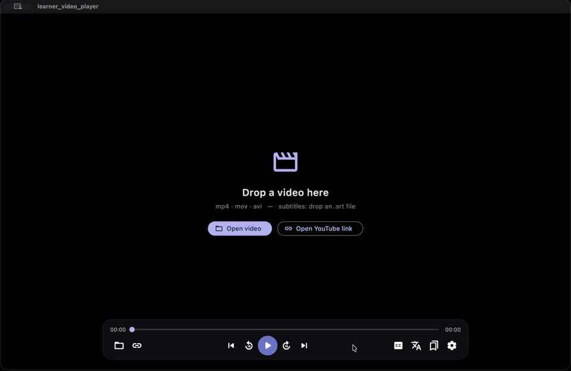
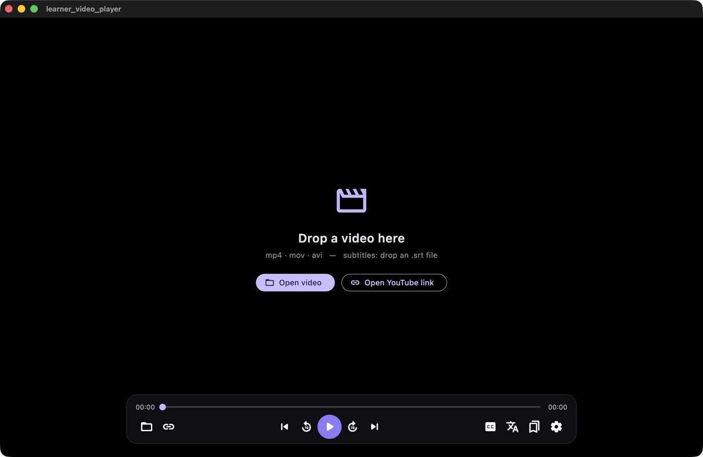
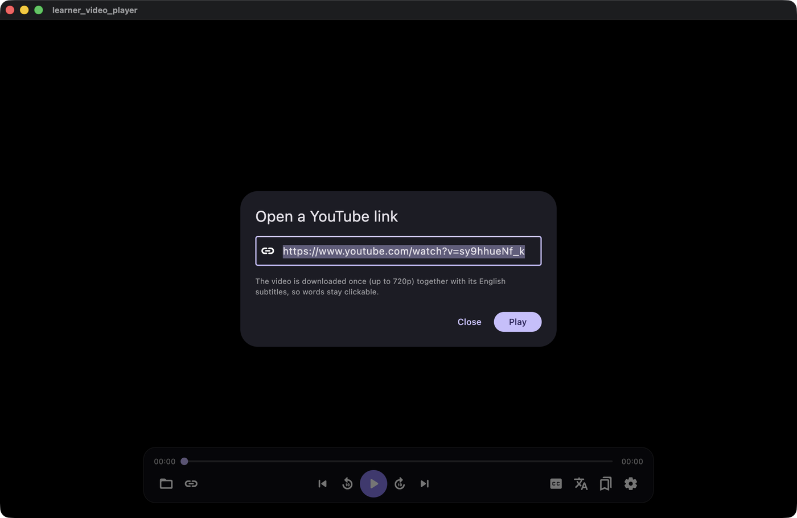
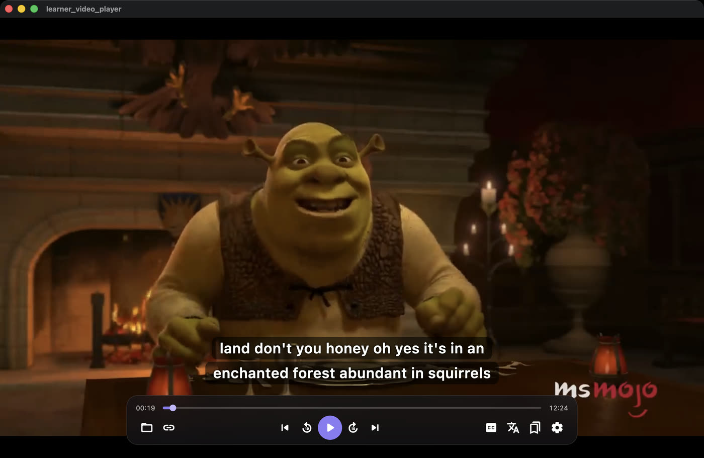
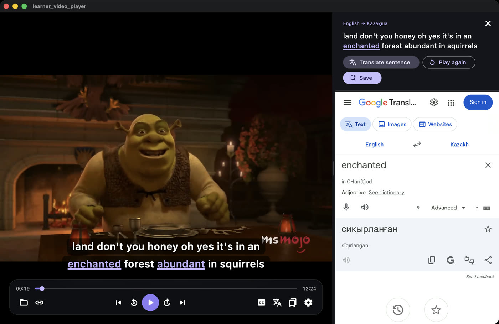
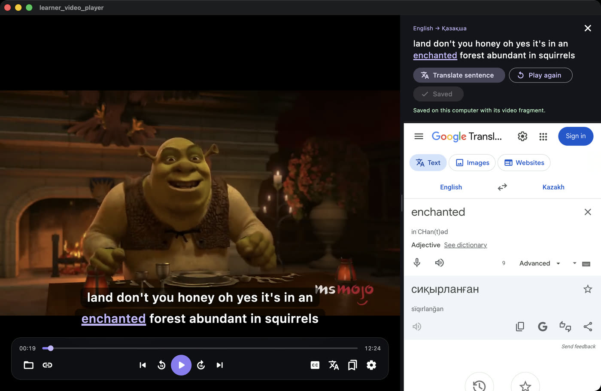
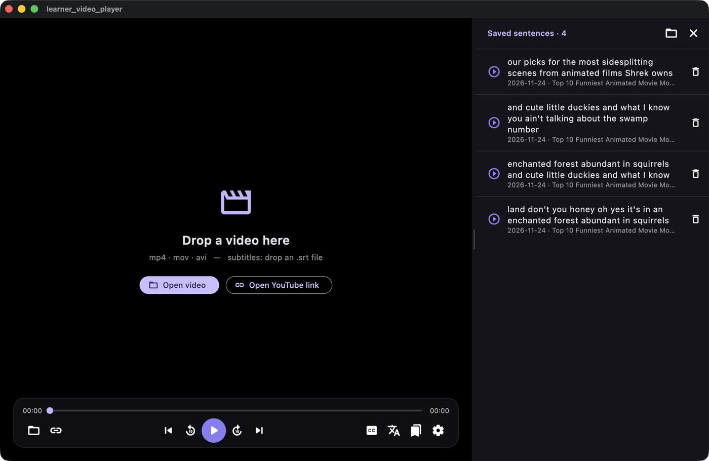
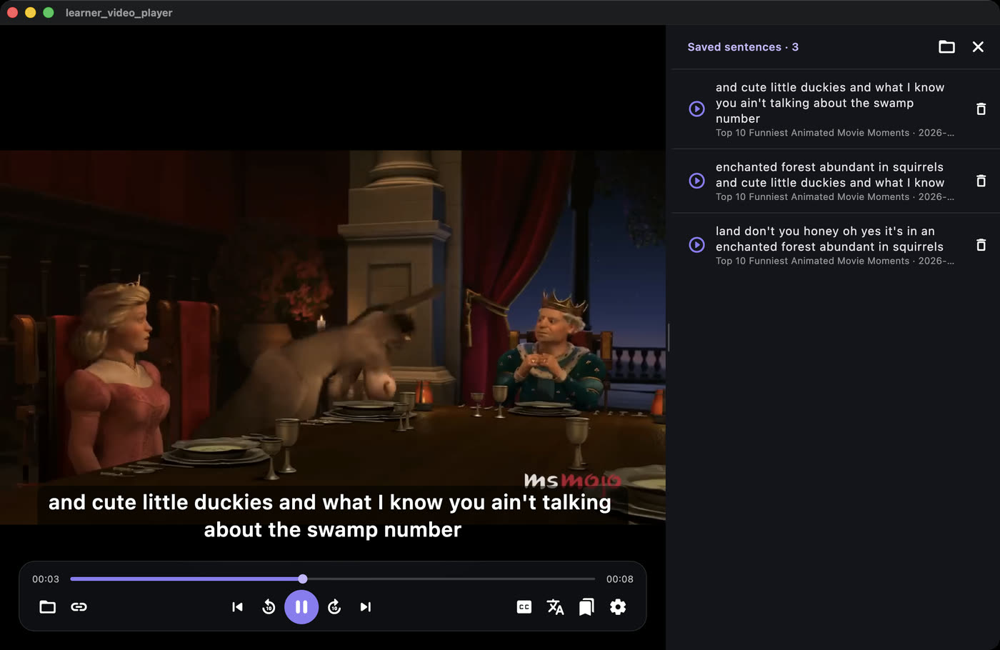
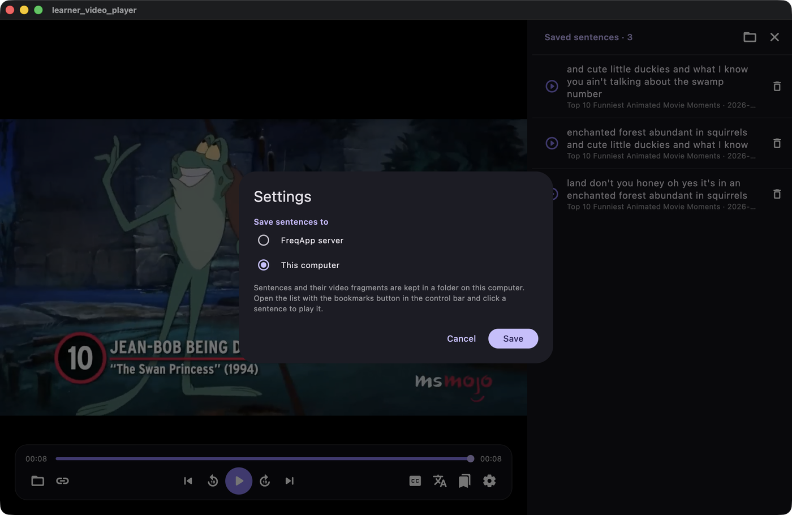

# Learner Video Player

A desktop video player for people who learn English by watching movies and series.

**Click any word in the subtitles → the video pauses → a Google Translate panel slides in on the right, inside the same window, with that word translated into your language.**



- Plays `mp4`, `mov` and `avi` files, and **YouTube links** (with English subtitles)
- Every subtitle word is clickable; translate a word or the whole sentence, replay the sentence
- **Save a sentence with its video fragment**: on your own computer (a list you can browse and replay) or to a FreqApp server
- Jump back and forward 10 seconds, or to the previous / next sentence
- Pick the audio track and the subtitles, or load your own `.srt` file
- Translates from English into the language you choose (Kazakh by default, your choice is remembered)

Works on **macOS**. The ready-made app is built for Macs with an Apple chip (M1 or newer). Windows is not supported yet.

---

## Table of contents

- [Install](#install): one Homebrew command, or a `.dmg` file
- [Quick tour](#quick-tour): a short guide with screenshots
- Build from source: [what you need](#1-build-from-source-what-you-need), [install the tools](#2-build-from-source-install-the-tools), [download and start](#3-build-from-source-download-and-start-the-app)
- [How to use it (details)](#4-how-to-use-it-details)
- [Troubleshooting](#5-troubleshooting)
- [For developers](#6-for-developers)

---

## Install

Pick **one** of the two ways. You do not need to know how to program, and you do not need Xcode or Flutter.

> **What is the Terminal?** It is a window where you type commands.
> On a Mac press `Cmd + Space`, type `Terminal` and press `Enter`.
> Every grey box below that looks like code is a command: copy it, paste it into the Terminal, press `Enter`, and wait until it finishes.

### Way 1. One command with Homebrew (recommended)

[Homebrew](https://brew.sh) is a tool that installs apps from the Terminal.

**Step 1. Check whether you already have it.** Run:

```bash
brew --version
```

- If it prints a version (for example `Homebrew 4.x`), **you already have it: go straight to Step 3.**
- If it says `command not found: brew`, do Step 2 first.

**Step 2. Install Homebrew (only if Step 1 said `command not found`).** Skip this step otherwise.

```bash
/bin/bash -c "$(curl -fsSL https://raw.githubusercontent.com/Homebrew/install/HEAD/install.sh)"
```

When it finishes it prints **Next steps** with two or three commands. Copy and run those too, then open a new Terminal window. More details are in [Build from source, Step 2](#step-2-install-homebrew-a-tool-that-installs-other-tools).

**Step 3. Install the app:**

```bash
brew install --cask nixwins/tap/learner-video-player
```

This puts **Learner Video Player** into your **Applications** folder and installs `ffmpeg` and `yt-dlp` (they are used for saving video fragments and for YouTube links). macOS does not block the app when it is installed this way. Open it from **Launchpad** or **Applications**.

| I want to… | Command |
| --- | --- |
| Update the app (and yt-dlp) | `brew upgrade --cask learner-video-player && brew upgrade yt-dlp` |
| Remove the app | `brew uninstall --cask learner-video-player` |

### Way 2. Download the app file (.dmg)

Everything is inside, including `ffmpeg` and `yt-dlp`. No Homebrew needed.

1. Open the [Releases page](https://github.com/nixwins/learner-video-player/releases/latest) and download the file called `LearnerVideoPlayer-…-arm64.dmg`.
2. Double-click the downloaded file. A window opens: **drag Learner Video Player onto the Applications folder**.
3. Open **Applications** and start the app. **The first time, macOS will refuse to open it**, because the app is not signed with a paid Apple certificate. Allow it once:
   - **Right-click** the app, choose **Open**, then click **Open** in the question that appears.
   - If macOS only offers **Done**: open **System Settings → Privacy & Security**, scroll down to the message about *Learner Video Player* and click **Open Anyway**.
   - Or run this in the Terminal: `xattr -dr com.apple.quarantine "/Applications/Learner Video Player.app"`

To update, download the newer `.dmg` and replace the app in **Applications**. YouTube changes often, so if a YouTube link stops working, install the newest version.

The packaged `ffmpeg` is a GPL build from [martin-riedl.de](https://ffmpeg.martin-riedl.de) and `yt-dlp` comes from [its official releases](https://github.com/yt-dlp/yt-dlp/releases).

> **Intel Mac?** The ready-made app does not run on it yet. [Build it from source](#1-build-from-source-what-you-need) instead.

---

## Quick tour

A five-minute walk through the app. The window below is the real app.

### 1. Start

Start the app. You see a drop zone. Choose how to open a video:

- **Open video**: pick an `mp4`, `mov` or `avi` file (or just drag the file onto the window), or
- **Open YouTube link**: watch a YouTube video with English subtitles.



### 2. Open a YouTube link

Paste a link and press **Play**. If you have a YouTube link in your clipboard, it is already filled in. The video is downloaded once (up to 720p) together with its English subtitles, so the first start takes a moment. Next time it opens instantly.



### 3. Watch with clickable subtitles

The subtitles are drawn by the app, so **every word is clickable**. Move the mouse to show the control bar:

| Button | What it does |
| --- | --- |
| Folder / link icons | Open a video file / a YouTube link |
| ⏮ and ⏭ | Previous / next subtitle sentence |
| ↺10 and ↻10 | Back / forward 10 seconds |
| Big round button | Play / pause (or press **Space**) |
| **CC** | Choose subtitles or load an `.srt` file |
| Translate icon | Choose the language you translate into |
| Bookmarks icon | Your [saved sentences](#6-see-your-saved-sentences) |
| Gear | [Settings](#7-settings) |



### 4. Click a word to translate it

Click any word. The video **pauses** and a panel opens on the right with:

- the **whole sentence** (click other words in it to translate them),
- **Translate sentence**: translates the entire sentence,
- **Play again**: replays just this sentence in the video,
- **Save**: keeps this sentence together with its video fragment,
- Google Translate with the translation of the word you clicked.

Drag the thin line between the video and the panel to change its width. Press **Esc** to close the panel and **Space** to continue watching.



### 5. Save a sentence

Press **Save**. The app cuts out exactly this sentence (with a little room before and after) as a short `.mp4` and keeps it. The button turns into **Saved**. Each sentence can be saved once, so you cannot create duplicates by accident.



### 6. See your saved sentences

Click the **bookmarks icon**. Your saved sentences appear on the right, newest first. **Click a sentence to play its video fragment**; the sentence is shown as a subtitle, so you can still click its words. The folder icon shows the files in Finder and the bin icon deletes a sentence.





### 7. Settings

Click the **gear icon**. Under **Save sentences to** choose where **Save** puts sentences:

- **This computer** (the default): files and a list on your Mac, no account needed.
- **FreqApp server**: upload to your FreqApp server. Enter its address and your API key ([details below](#saving-to-the-freqapp-server)).



> The video in the screenshots is "Top 10 Funniest Animated Movie Moments" by MsMojo. It is shown only to demonstrate the app; all rights belong to its owners.

---

## 1. Build from source: what you need

| Thing | Why | Free? |
| --- | --- | --- |
| A Mac (macOS 10.15 or newer) | To run the app | – |
| Internet connection | To download tools once, and for Google Translate while watching | – |
| About 10 GB of free disk space | Xcode and Flutter are big | – |
| **Flutter** | The framework the app is built with | Yes |
| **Xcode** | Builds the native app | Yes |
| **Git** | Downloads the project | Yes |
| **yt-dlp** (optional) | Only needed to open YouTube links | Yes |
| **ffmpeg** (optional) | Only needed to save sentences with a video fragment | Yes |

You do **not** need to know how to program. You will copy and paste a few commands.

> **What is the Terminal?** It is a window where you type commands.
> On a Mac press `Cmd + Space`, type `Terminal` and press `Enter`.
> Every grey box below that looks like code is a command: copy it, paste it into the Terminal, press `Enter`, and wait until it finishes.

---

## 2. Build from source: install the tools

### Step 1. Install Xcode

1. Open the **App Store**, search for **Xcode** and click **Get**. It is large (several GB), so it takes a while.
2. When it has installed, open **Terminal** and run these two commands (the first asks for your Mac password; you will not see the characters while typing, that is normal):

```bash
sudo xcodebuild -runFirstLaunch
sudo xcodebuild -license accept
```

### Step 2. Install Homebrew (a tool that installs other tools)

Skip this step if you already have Homebrew (check with `brew --version`).

```bash
/bin/bash -c "$(curl -fsSL https://raw.githubusercontent.com/Homebrew/install/HEAD/install.sh)"
```

When it finishes, it prints a section called **Next steps** with two or three commands. **Copy and run those commands too**, otherwise the `brew` command will not be found.

### Step 3. Install Git, CocoaPods and Flutter

```bash
brew install git cocoapods
brew install --cask flutter
```

### Step 4. Install yt-dlp and ffmpeg (optional)

```bash
brew install yt-dlp ffmpeg
```

- **`yt-dlp`** is needed to open YouTube links. YouTube changes often, so if downloads stop working, update it with `brew upgrade yt-dlp`.
- **`ffmpeg`** is needed to **save sentences with their video fragment** (see [Save a sentence](#save-a-sentence)). It also lets YouTube downloads use better quality (up to 720p).

You can skip this step and install them later.

### Step 5. Check that everything is ready

```bash
flutter doctor
```

You should see green check marks next to **Flutter** and **Xcode - develop for iOS and macOS**.
Other lines (Android, Chrome) can be ignored: this app only needs macOS.

If something under macOS is red, see [Troubleshooting](#5-troubleshooting).

---

## 3. Build from source: download and start the app

### Step 1. Download the project

```bash
cd ~
git clone https://github.com/nixwins/learner-video-player.git
cd learner-video-player
```

### Step 2. Install the project's packages and run the checks

```bash
chmod +x setup.sh
./setup.sh
```

This downloads the libraries the app uses, switches off a macOS setting that would stop the player from reading your video files (see [the note below](#a-note-about-the-macos-sandbox)), and runs the automatic tests. At the end you should see `All tests passed!` and `Ready.`

The first run takes a few minutes. You only need to do this step once.

### Step 3. Start the app

```bash
flutter run -d macos
```

The first start takes a few minutes because the app is being built. Next starts are much faster. A window called **learner_video_player** will open.

To stop the app, close its window, or press `q` in the Terminal.

### Starting it again later

Open Terminal, go to the project folder and run it again:

```bash
cd ~/learner-video-player
flutter run -d macos
```

### Updating to a newer version

```bash
cd ~/learner-video-player
git pull
flutter pub get
flutter run -d macos
```

### A note about the macOS sandbox

By default macOS apps are "sandboxed" and may only read files you explicitly allow. A video player has to read the video **and** the subtitle file next to it, so `setup.sh` turns the App Sandbox **off** for this project. This is fine for an app you build and run yourself. It would have to be redone properly before publishing to the Mac App Store.

---

## 4. How to use it (details)

### Open a video

- Click the **folder icon** at the bottom left and choose a video file, **or**
- **Drag and drop** a video file onto the window.

### Pause and play

- Click the **play / pause button**, press **Space**, or click the video.
- The control bar hides itself while the video plays. Move the mouse to show it again.

### Choose the audio track

Click the **music note** button in the control bar and pick a track (for example the original English one).

### Watch a YouTube video

1. Click the **link icon** in the control bar (or **Open YouTube link** on the start screen).
2. Paste the link and press **Play**. If your clipboard already holds a YouTube link, it is filled in for you.
3. The video is downloaded once (up to 720p) together with its **English subtitles**, then it plays like any other file. A second time it opens instantly.

Clicking words, translating a sentence and **Play again** work exactly as with a local file. If the video has no English subtitles, you will be told, and you can load an `.srt` yourself.

Only English subtitles are used. Hand-written subtitles are preferred; otherwise YouTube's automatic captions are used (the app removes the repeated lines these captions contain).

Downloaded videos are kept in the system's temporary folder, so macOS cleans them up by itself.

### Save a sentence

You can save the sentence you are looking at, **together with just its video fragment**, in one of two places. Choose it once in **Settings** (gear icon in the control bar), under **Save sentences to**:

- **This computer** — the sentence and its `.mp4` fragment are kept in a folder on your Mac and listed inside the app. No account or internet needed.
- **FreqApp server** — the sentence and fragment are uploaded to your FreqApp server.

If you never chose, the app uses **This computer**, or the server if you had already set it up.

**Saving a sentence**

1. Click a word in the subtitles so the panel opens.
2. Press **Save** under the sentence.
3. The app cuts the fragment of that sentence out of the video as an `.mp4` (with `ffmpeg`) and stores it. The button changes to **Saved**.

Good to know:
- Each sentence can be saved only once from the app, so you do not create duplicates by accident.
- The fragment starts a little before the sentence and ends a little after it, and uses the audio track you picked.
- If the exact timing of the sentence is unknown (for example picture-based subtitles), the sentence is saved without a video, and you are told so.

#### Your saved sentences (on this computer)

Click the **bookmarks icon** in the control bar. A list opens on the right, newest first:

- **Click a sentence** to play its video fragment. The sentence is shown as a subtitle, so you can click its words and translate them as usual. Note that this replaces the video that is open now.
- The **folder icon** shows the saved files in Finder; the **bin icon** deletes a sentence and its files (after asking).
- Everything lives in `~/Library/Application Support/dev.learner.learnerVideoPlayer/sentences/`: a SQLite database (`sentences.db`) and the files `sentence-<number>.mp4` / `.srt`. The list is only about sentences saved to **This computer**.

#### Saving to the FreqApp server

1. In **Settings** choose **FreqApp server**.
2. Fill in:
   - **Server address**, for example `https://freqapp.example.com` (ask whoever runs the server). Just the address, without `/api/v1/sentences`.
   - **API key**, which starts with `tvs_`. An admin creates it in FreqApp under **Settings → API keys** and it is shown **only once**, so copy it right away.
3. Press **Save**.

Click the eye icon in the key field to check what you typed. **To replace the key** later, open Settings, type the new key over the old one and press **Save**. The new key is used immediately. The key is stored on this computer only and is only ever sent to the server address you entered.

Good to know:
- If you chose the server but have not entered the address and key yet, **Save** opens Settings first and then saves.
- If the connection drops while saving, the message says the sentence **may** already be saved: check on the server before saving it again.
- The server accepts videos up to 100 MB and 30 saves per minute. A short fragment is far below the size limit.

### Subtitles

Click the **CC** button in the control bar:

- Pick one of the subtitle tracks that are inside the video file, or
- choose **Off** to hide them, or
- choose **Load file…** and select an `.srt` file. You can also **drag an `.srt` file onto the window**.

### Translate a word

1. Make sure subtitles are on.
2. **Click any word** in the subtitle.
3. The video pauses and a **translation panel opens on the right**, in the same window (English → your language). The video shrinks to make room, and the word stays highlighted in the subtitle.
4. Drag the thin divider between the video and the panel to change the panel width. The app remembers it.
5. Click a different word to translate it, or close the panel with the **×** button or the **Esc** key.
6. Press **Space** (or click the video) to continue watching.

### Change the language you translate into

Click the **translate** button (the one with the two letters) in the control bar and pick a language. The app remembers it next time.

### Keyboard shortcuts

| Key | Action |
| --- | --- |
| `Space` | Play / pause |
| `←` / `→` | Back / forward 10 seconds |
| `Shift` + `←` / `→` | Previous / next subtitle sentence |
| `Esc` | Close the translation panel |

### Not supported yet

- Volume slider and full screen
- Picture-based subtitles (PGS / VobSub, common on Blu-ray rips). They are images, not text, so words cannot be clicked. Use a text subtitle track or an `.srt` file instead.

---

## 5. Troubleshooting

**macOS says the app "cannot be opened", "is from an unidentified developer" or "is damaged"** (only for the `.dmg` download)
The app is not signed with a paid Apple certificate. Allow it once: right-click the app → **Open** → **Open**, or run `xattr -dr com.apple.quarantine "/Applications/Learner Video Player.app"`. See [Install, way 2](#way-2-download-the-app-file-dmg).

**`brew install --cask nixwins/tap/learner-video-player` says the tap or cask was not found**
Run `brew update` and try again. Check that you copied the whole command, including `nixwins/tap/`.

**`zsh: command not found: flutter`**
Flutter is not on your PATH. Close the Terminal and open a new one. If it still fails, run `brew install --cask flutter` again and read what Homebrew prints at the end.

**`zsh: command not found: brew`**
Homebrew's "Next steps" commands (end of [Step 2](#step-2-install-homebrew-a-tool-that-installs-other-tools)) were not run. Run them, then open a new Terminal window.

**`zsh: permission denied: ./setup.sh`**
Run `chmod +x setup.sh` once, then `./setup.sh` again.

**`flutter doctor` says Xcode is incomplete, or asks to accept the license**
Run:

```bash
sudo xcode-select --switch /Applications/Xcode.app/Contents/Developer
sudo xcodebuild -runFirstLaunch
sudo xcodebuild -license accept
```

**`flutter doctor` says CocoaPods is not installed**
Run `brew install cocoapods`.

**The build fails with a CocoaPods / `pod install` error**

```bash
cd macos
pod repo update
cd ..
flutter clean
flutter pub get
flutter run -d macos
```

**The video does not play, or there is no sound**
Make sure the file is a normal `mp4`, `mov` or `avi`. Try another file to check that it is not the file itself.

**"yt-dlp is not installed"**
Run `brew install yt-dlp`. If you just installed it, restart the app.

**"YouTube refused the download (HTTP 403)"** or other YouTube errors
yt-dlp is out of date. Run `brew upgrade yt-dlp` (or `pip install -U yt-dlp` if you installed it with pip) and try again.

**"This video has no English subtitles"**
Some videos have none. Load your own `.srt` with the **CC** button, or choose another video.

**"ffmpeg is not installed" when saving a sentence**
Run `brew install ffmpeg`, then press **Save** again.

**"The API key is wrong or was revoked"**
Open **Settings** (gear icon), enter a valid key and press **Save**. Ask the FreqApp admin for a new key if needed.

**"Cannot connect to …" when saving a sentence**
Check the **Server address** in Settings and your internet connection.

**Subtitles do not appear**
Open the **Subtitles** menu and choose a track, or choose **Load file…** and pick an `.srt`. Put the subtitle file next to the video with the same name (`movie.mp4` + `movie.srt`) if you want to find it easily.

**The translation panel shows "Could not load the translation"**
It needs an internet connection. Check it and press **Retry**.

**Clicking a word does nothing**
Subtitles in the video may be picture-based. Switch to another subtitle track or load an `.srt` file.

**Anything else**
Run the app with `flutter run -d macos` and look at the messages in the Terminal. Copy them into a new issue at <https://github.com/nixwins/learner-video-player/issues>.

---

## 6. For developers

### Build a disk image (.dmg)

```bash
./scripts/make_dmg.sh
```

It builds the release app, creates a slim `.zip` for the Homebrew cask (`packaging/homebrew/learner-video-player.rb`, copy it to `Casks/` in the `nixwins/homebrew-tap` repository and update `version` and `sha256`), downloads ffmpeg and yt-dlp for your CPU, puts them into `Contents/Resources/bin` (the app looks there first), signs everything ad-hoc and creates `build/dmg/LearnerVideoPlayer-<version>-<arch>.dmg`. The result only runs on the CPU type you built on.

### Commands

```bash
flutter pub get      # install packages
flutter analyze      # static analysis
flutter test         # run unit and widget tests
```

### Architecture (feature-first, 3 layers)

`presentation → domain ← data`. The `domain` layer is plain Dart code plus interfaces.

```
lib/
  core/            shared: Choice, languages, media types, duration format, OptionMenuButton
  features/
    player/        PlayerGateway (domain) ← MediaKitPlayerGateway (data); page, controls, menus
    subtitles/     tokenizeSubtitle (domain); ClickableSubtitle (presentation)
    translation/   buildTranslateUri, TranslateWord, TranslationLauncher (domain);
                   WebviewTranslationLauncher (data); TranslationPanel (presentation)
    youtube/       VideoResolver, youtubeVideoId, cleanAutoCaptions (domain);
                   YtDlpVideoResolver (data); open-link dialog (presentation)
    sentences/     SaveSentence, SentenceRepository, SentenceLibrary, ClipCutter (domain);
                   FreqAppApi, SqliteSentenceLibrary, FfmpegClipCutter (data);
                   Save button, saved-sentences panel (presentation)
    settings/      SettingsRepository (domain) ← PrefsSettingsRepository (data); native language
  main.dart        composition root: the only place that wires concrete implementations
```

### Libraries

| Library | Used for |
| --- | --- |
| `media_kit` (libmpv) | Playback, audio tracks, subtitle tracks and the text of the current subtitle |
| `webview_flutter` | The translation panel (embedded web view) |
| `flutter_riverpod` | State management and dependency injection |
| `shared_preferences` | Remembering the chosen language, the save destination and the server settings |
| `sqflite_common_ffi` | The SQLite list of sentences saved on this computer (`sqlite_sentence_library.dart`) |
| `path_provider` | Finding the app's data folder |
| `file_selector` | Open-file dialogs |
| `desktop_drop` | Drag and drop |
| `http` | Sending sentences to the FreqApp API (one file, `freqapp_api.dart`) |
| `ffmpeg` (external program) | Cuts the video fragment of a sentence; used in one file, `ffmpeg_clip_cutter.dart` |
| `yt-dlp` (external program) | Downloads YouTube videos and subtitles; used in one file, `ytdlp_video_resolver.dart` |

Each third-party library is used in exactly one file (or one thin layer), so it can be replaced without touching the UI.

### Known limits

- Picture-based subtitles (PGS / VobSub) cannot be clicked (no OCR).
- Whether a `.srt` next to the video is picked up automatically depends on mpv; if it is not, load it manually.
- No volume slider and no full screen yet.
- macOS only: `webview_flutter` has no Windows implementation.
